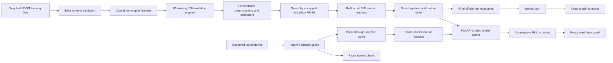

# Connected pipeline

`ml.engines.preprocess.make_features` is the single feature implementation. Transformations are fitted inside the candidate pipeline on training engines only. Validation uses whole held-out engines and three prefix endpoints per engine. Official test labels are accessed only by inspection/evaluation, not the runtime prediction service.

The model is selected before final test evaluation. Repeating training with the same file hashes, versions, and seed reproduces the experiment, subject to platform floating-point differences. A single fixed validation split is a limitation: the reported test score is not a cross-validation confidence interval.

FastAPI loads the trusted model and parses test trajectories once at startup. It uses a supplied history prefix for inference, so requests cannot inspect unobserved cycles. The built React app is mounted after API routes on the same origin. There are no mock API paths, generated telemetry streams, or random fallback predictions.

The UI aborts obsolete requests when engine or cycle selection changes. A prediction result is cleared whenever its inputs change. Session history records completed requests only and is lost on refresh. CSV export includes exactly the selected engine’s observed prefix.
